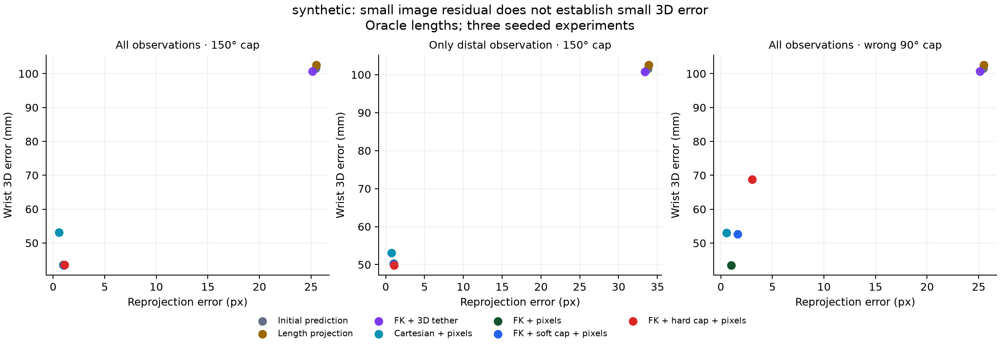
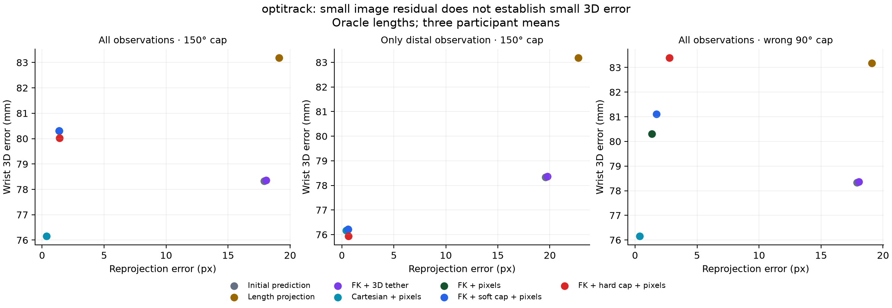

# Geometric consistency and reconstruction accuracy

## Abstract

This study examines whether segment-length constraints and image fitting improve 3D
reconstruction of a two-link limb. An exact perspective example admits two geometrically
valid solutions with identical projection. In 1,536 seeded synthetic chains, fixed-length
refinement reduces mean wrist error from 101.5 to 43.5 mm. In a retrospective audit of
5,414 chain observations from three evaluation participants, the same refinement reduces
image residual from 17.91 to 1.36 px while wrist error increases from 78.3 to 80.3 mm.
The result separates constraint satisfaction, agreement with observations and reference
accuracy. It does not establish a new end-to-end pose estimator or clinical validity.

The companion technical article is Ajish Pradeep (28 October 2026),
[A valid reconstruction can still be the wrong one](https://ajishpradeep.com/blog/a-valid-reconstruction-can-still-be-the-wrong-one/).
This report connects its argument to the released implementation and measurements.

## Methods

### Model and objective

A chain has root position $r$, segment lengths $l_1,l_2$ and unit segment directions
$d_1,d_2$. Forward kinematics gives the elbow and wrist positions:

$$
p_1=r+l_1d_1,\qquad p_2=r+l_1d_1+l_2d_2.
$$

The seven state variables are the free root's three coordinates, two proximal orientation
angles, a bending-plane angle and an inter-segment bend angle. Positions are metres in the
camera frame and angles are radians. Fixed lengths hold by construction. Three joint
centres do not identify axial twist or an anatomical elbow coordinate system.

Given initial positions $p_j^0$, observed pixels $u_j$, camera projection $\pi_K$ and
observation weights $w_j$, refinement minimizes

$$
\mathcal L = \sum_j \frac{\|p_j-p_j^0\|^2}{(0.08\,\mathrm m)^2}
+ \sum_j w_j\frac{\|\pi_K(p_j)-u_j\|^2}{(5\,\mathrm{px})^2}
+ \mathcal L_{\mathrm{cap}} + \mathcal L_{\mathrm{depth}}.
$$

The depth penalty discourages positions below 0.05 m. Soft caps penalize bend excess with
a 10° scale; hard caps use a sigmoid parameterization. The 150° cap is an illustrative
setting and the 90° cap a deliberate misspecification. Neither is patient-specific range
of motion. The tether and confidence weighting are engineering choices, not calibrated
posterior uncertainty.

The seven comparisons are the initial prediction, root-outward length correction, FK
with only the 3D tether, Cartesian pixel refinement, and FK pixel refinement without a
cap, with a soft cap or with a hard cap. Inputs and optimization budgets are matched.
Adam uses learning rate 0.02, 200 steps, CPU float64 and four threads. A separate control
uses 400 steps. Projection follows the OpenCV pinhole/distortion convention.

### Exact perspective ambiguity

Take a known root at $(0,0,3)$ m and a segment length of 0.5 m. A distal point on the
camera ray $(0.1z,0,z)$ has the prescribed length when

$$
1.01z^2-6z+8.75=0.
$$

The positive depths are 2.571 and 3.369 m. The two points are approximately 798 mm apart,
yet have identical projection and zero length violation. Numerical tests verify both
invariants. This example proves ambiguity under these measurements, not a universal
monocular impossibility result.

### Experimental design

**Synthetic mechanism check.** Seeds 17, 29 and 43 each generate 512 chains with random
orientations, translations, lengths and bends. Angular and coordinate perturbations
corrupt initial poses; Gaussian noise corrupts image observations. The generator and
estimator share geometry. Controls vary lengths (generic, reference and ±10% reference),
confidence weighting, proximal observation dropout, a confidently wrong distal observation,
and bend bounds. Methods share the same draws.

**Retrospective real-data audit.** Cached monocular upper-limb sports predictions are
compared with a synchronized OptiTrack Motive fitted skeleton. Four development participants
supply generic lengths; three participants excluded from predictor training supply the
evaluation observations. Both arms and two camera views contribute repeated chains.
Every fifth cached row is sampled, approximately 6 Hz from a 30 Hz cache. Eligible swing
rows require finite observations and valid depth. The retained counts are 1,668 development
and 5,414 evaluation chains. No new predictor training or checkpoint selection is performed.

All methods receive calibration and reference pelvis translation. Participant-specific
reference lengths and reference-projected pixels are privileged diagnostics. Observation
dropout removes terms from refinement while keeping the upstream prediction unchanged;
it does not occlude images or rerun the detector.

Metrics distinguish wrist/joint 3D error, wrist camera-depth error, geometric bend error,
visible-keypoint image residual, reference-length error and imposed-length violation.
Participant or seed means are weighted equally. Frames, arms and views are repeated
observations, not independent participants; no frame-bootstrap precision is claimed.

## Results

### Matched synthetic geometry favors fixed-length refinement

| Method | Mean wrist error (mm) |
|---|---:|
| Initial prediction | 101.5 |
| Root-outward length correction | 102.5 |
| Cartesian pixel refinement | 53.1 |
| Fixed-length FK with pixels | 43.5 |
| FK with a hard 90° cap | 68.8 |

An incorrect active bound removes part of the gain. These equal-weight seed means verify
behavior under the generator; they do not validate human anatomy.



### The real-data ranking differs

The primary condition uses reference-derived lengths, confidence-weighted detected pixels
and a 150° cap where applicable. Values below average the three evaluation participant means.

| Method | Wrist 3D (mm) | Depth (mm) | Image residual (px) | Length deviation (mm) |
|---|---:|---:|---:|---:|
| Initial prediction | 78.3 | 49.6 | 17.91 | 18.83 |
| Root-outward length correction | 83.2 | 47.1 | 19.10 | 0.00 |
| Cartesian pixel refinement | 76.2 | 48.3 | 0.37 | 24.73 |
| Fixed-length FK with pixels | 80.3 | 53.1 | 1.36 | 0.00 |
| FK with soft 150° cap | 80.3 | 53.1 | 1.36 | 0.00 |
| FK with hard 150° cap | 80.0 | 52.8 | 1.39 | 0.00 |

Exact lengths and much lower image residual do not improve mean wrist accuracy here.
Cartesian refinement gives a lower mean wrist error with greater length distortion.
The mostly inactive 150° cap contributes little.

| Evaluation participant | Chains | Initial wrist (mm) | FK with pixels (mm) |
|---|---:|---:|---:|
| P01 | 2,586 | 78.3 | 71.7 |
| P05 | 1,480 | 77.8 | 92.5 |
| P07 | 1,348 | 78.9 | 76.8 |

The participant effects are heterogeneous: a macro mean does not describe a uniform benefit.



### Observation and optimization controls

Replacing detected pixels with projections of the reference skeleton changes uncapped FK
wrist error from 80.4 to 39.3 mm and depth error from 53.2 to 38.5 mm at 400 steps.
Localization and landmark correspondence change together, so their effects are not isolated.
The pixels and lengths also share the reference construction: this is an oracle diagnostic,
not independent validation.

In the checked full-observation setting, increasing the budget from 200 to 400 steps changes
participant-level wrist error by less than 0.5 mm. This addresses the tested budget without
proving global convergence. Both controls were designed after inspecting the pilot and are
exploratory. [Complete generated tables](../results/tables.md) retain all released main-run
conditions, including results omitted from the summary tables above.

## Discussion and limitations

The rank reversal makes observation quality and anatomical correspondence central to
interpreting refinement. A chain can be structurally consistent and agree closely with
pixels while retaining substantial reference error. Remaining depth error alone cannot
identify whether localization, landmark definition, calibration or geometry caused it.

The reference is a Motive fitted skeleton rather than direct bone motion. The cohort is
small, sports-specific and previously inspected; reference lengths, calibration and root
translation simplify the inference problem. These findings do not establish population,
fairness, gait, home-monitoring, clinical or on-device validity. No external estimator is
reproduced or outperformed.

An implementation audit found that detector inputs were already undistorted. The adapter
uses zero distortion and checks reference projections against cached pixels. The initial
run with double-applied distortion is invalid and superseded by the corrected released
results. The uncapped FK-with-pixels control and bound-compliance metrics were
added after the initial synthetic pilot. The historical protocol and amendments remain
unchanged inside the source archive; the study is exploratory, not an independent
preregistered confirmation.

## Reproducibility

From an installed checkout, the following reproduces the synthetic settings and regenerates
tables and figures from the released aggregates:

```sh
python -m observability run --out local/synthetic --synthetic-n 512 --steps 200
python -m observability report --results results --out local/report
cmp results/tables.md local/report/tables.md
python -m observability verify
python -m unittest discover -s tests -v
```

`run` writes aggregate CSVs and execution manifests; `report` reads aggregates and does not
execute an estimator. A quick execution check uses `--synthetic-n 8 --steps 2 --smoke` and
is not an experimental replication. `kinematic-observability` exposes the same commands.

Real-data recordings, individual trajectories and predictor weights are not distributed.
The real-data experiment therefore requires separately authorized inputs; its aggregates
can be inspected and verified without them.

<details>
<summary>Local input format and cache adaptation</summary>

The runner loads a NumPy `.npz` archive with pickle disabled. Each row is one
shoulder–elbow–wrist chain in camera coordinates. Numeric arrays and non-object string
labels use the following fields:

| Field | Shape | Meaning |
|---|---|---|
| `truth`, `initial` | `(N, 3, 3)` | Reference and initial positions in metres |
| `uv` | `(N, 3, 2)` | Pixel observations |
| `confidence` | `(N, 3)` | Heuristic weights; weighted conditions clip to `[0.05, 1]` |
| `K` | `(N, 3, 3)` | Intrinsic matrices |
| `dist` | `(N, 5)` | OpenCV `k1, k2, p1, p2, k3`; zero for undistorted images |
| `oracle_lengths`, `generic_lengths` | `(N, 2)` | Reference and development-mean lengths in metres |
| `subject`, `cohort`, `view` | `(N,)` | Opaque participant/seed, split and view labels |

Cohort values are `within` (development), `new` (evaluation) or `synthetic`. The `all` view
is reserved for aggregate output. The adapter additionally retains opaque `capture`, integer
`frame` and `side` fields for local correspondence audits; these are not exported as trajectories.
Projection clamps depth to 0.05 m for numerical stability; this is not a physical near-camera model.

The `prepare` adapter expects the historical `report/frames.npz` and per-capture caches,
rather than arbitrary Motive exports. That historical report cache contains an object
column and requires pickle loading; use only trusted inputs. The adapter verifies frame,
projection and pelvis/camera conventions, filters eligible rows, and records hashes and
counts. Its local manifest contains source paths but no identity map. Output must be under
`local/` in the working directory.

```sh
python -m observability prepare --cohort-root /path/to/authorized/cache --out local/cohort.npz
python -m observability run --data local/cohort.npz --out local/cohort-run
python -m observability oracle --data local/cohort.npz --out local/oracle
```

</details>

<details>
<summary>Recorded artifacts, units and provenance</summary>

Each results directory contains `aggregates.csv` and an original execution manifest:

| Directory | Experiment |
|---|---|
| `results/synthetic/` | Three seeds, 200 steps |
| `results/optitrack/` | Real-data audit, 200 steps |
| `results/optitrack_400/` | Budget control, 400 steps |
| `results/oracle_pixels/` | Reference-projected pixel control, 400 steps |

Each CSV row identifies participant/seed, view, length condition, observations, cap and
method. `n` counts chains. Position, depth and length errors are millimetres, bend error is
degrees, image residual is pixels and compliance fractions lie in `[0, 1]`. Reporting selects
the `all` view and the real `new` cohort, then averages participant/seed means equally.

`results/baseline-source.zip` stores the six original Python files and `PROTOCOL.md` with
unchanged bytes. This preserves the source and protocol hashes named in the original
manifests. `results/artifacts.json` protects the archive, aggregates, manifests, generated
tables and figures. The verifier reads the archive without extracting or executing it and
checks finite metrics, matched counts, unique comparisons, length invariants and hard caps.
New runs record the maintained source hashes separately. The reorganization is not a new
experiment; recorded measurements have not been modified or relabelled.

</details>

## Citation

Pradeep, Ajish. (2026, October 28).
[A valid reconstruction can still be the wrong one](https://ajishpradeep.com/blog/a-valid-reconstruction-can-still-be-the-wrong-one/).
Personal technical article accompanying this study. It is the author's interpretation,
not an independent validation. [CITATION.cff](../CITATION.cff) provides machine-readable
article and software metadata. For a reproduction, also record the software version,
exact commit and execution manifest.

<details>
<summary>BibTeX</summary>

```bibtex
@misc{pradeep2026validreconstruction,
  author = {Pradeep, Ajish},
  title = {A valid reconstruction can still be the wrong one},
  year = {2026},
  month = oct,
  day = {28},
  url = {https://ajishpradeep.com/blog/a-valid-reconstruction-can-still-be-the-wrong-one/},
  note = {Personal technical article accompanying the kinematic-observability study}
}
```

</details>
