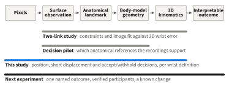
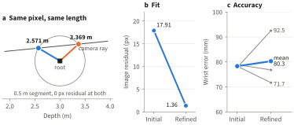
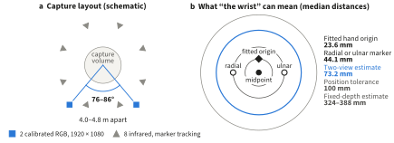
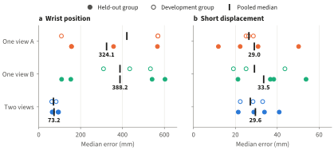
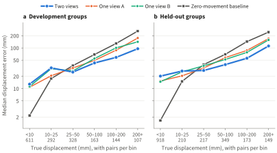
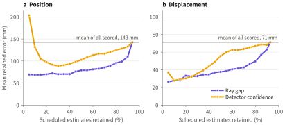
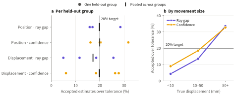
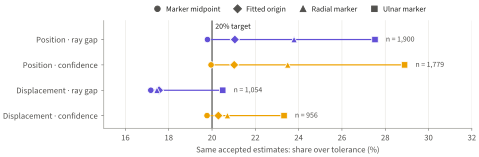

# What two cameras preserve about wrist motion

**Position, short displacement and the definition of the target in few-camera kinematics**

Ajish Pradeep · Independent research report · November 2026

## Abstract

Across 181 held-out laboratory recordings, a second calibrated camera reduced median wrist position error from 324–388 mm, for fixed-depth single-camera controls, to 73.2 mm. Median error in wrist displacement over 25–50 ms hardly changed, at 29.0–33.5 mm. That number turned out to be harder to read than it looked. The median true displacement was 13.9 mm, so a rule that always reported no movement would have scored better than any camera. Split by how far the wrist actually moved, the result becomes clearer. Below 10 mm the cameras reported 15–20 mm of movement that did not happen. At 50 mm and above, two views cut median error from about 71 mm to 52.5 mm. Detector confidence and the gap between camera rays ranked errors usefully, yet no fixed acceptance rule met its 20% failure target in every held-out group, and about a third of accepted displacement estimates failed when the wrist moved at least 50 mm. Changing the definition of the wrist changed which estimates failed. An accuracy figure for video kinematics means little until it names the movement and the target it applies to.

*Figure 1. The chain from pixels to an interpretable outcome, and the part of it each experiment examined.*

## 1. Where the question came from

I work on 3D pose estimation for fast sports movement. The output usually looks convincing, and I kept running into the same question: what is that appearance worth?

Two papers gave me a way in. Uchida and Seth (2022) showed that substantial uncertainty remains in computed kinematics and kinetics even when marker tracking errors are low, because registration and scaling errors survive a good fit. Lin et al. (2024) showed that OpenSim coordinates can be learned directly from video. Reading them together raised a question about video that I could test myself. Can a reconstruction keep its segment lengths, fit its image closely, and still be less accurate in 3D?

The geometry says yes before any data arrive. Take a root 3 m from the camera, a 0.5 m segment and a distal point on the ray (0.1*z*, 0, *z*). Two depths satisfy the length exactly, 2.571 m and 3.369 m, and both project to the same pixel (Figure 2a). A constraint removes possibilities. It does not say which of the remaining ones is true.

Then I measured it. On 1,536 synthetic two-link chains with matched geometry, fixed-length refinement reduced mean wrist error from 101.5 to 43.5 mm, so the method did its job when its model was right. On 5,414 recorded upper-limb observations from three held-out participants, the same refinement brought image residual down from 17.91 to 1.36 pixels while mean wrist error against a fitted skeleton went from 78.3 to 80.3 mm. The average concealed a spread: one participant improved by 6.6 mm and another worsened by 14.7 mm. Doubling the optimisation budget changed participant-level error by less than 0.5 mm, which made an unconverged solver an unlikely explanation.

*Figure 2. The two-link study. (a) Two solutions with the same pixel and the same segment length, drawn to scale. (b, c) On recorded data, refinement improved the fit without improving the wrist. Grey lines are individual held-out participants.*

The informative control came last. When I replaced detected keypoints with projections of the reference skeleton, wrist error fell from 80.4 to 39.3 mm. That moved my attention from the constraint to the observation, but it could not say why. The substitution changed where the pixel was and what the pixel meant at the same time. Separating detector error from landmark definition became the open problem, and it raised a more basic one. "Wrist error" assumes we agree on what the wrist is.

## 2. Deciding what to measure

There were several reasonable ways to continue: which body proportions images can actually identify, how little calibration a single camera can get away with, whether multi-view evidence can tell a single view when to abstain, whether a prior preserves unusual but valid movement, how much change survives setup drift between visits, whether force data can reject a wrong solution. Choosing among these from the literature alone would have meant choosing the most attractive idea. I ran a pilot instead, on recordings kept out of the later study, with thresholds fixed before its confirmation sample, and asked which questions the data could carry.

**The references decided the endpoint.** Table 1 comes from an audit of all 349 recordings. Elbow markers existed in most recordings but were present in only 6–10% of frames at the median. Median ankle coverage was zero. Shoulder markers were complete, yet sat 83–100 mm from the fitted shoulder origin, so they describe the skin above the joint. Only the paired radial and ulnar styloid markers were both widely available and continuously visible. The wrist became the endpoint because it was the one joint where I could construct a direct reference without filling gaps.

*Table 1. Reference availability across 349 recordings. Values are left / right.*

| Landmark | Recordings with the markers | Median frame coverage | Median distance to fitted origin |
|:---|---:|---:|---:|
| Wrist, styloid midpoint | 100% / 99.7% | 99.9% / 99.6% | 22.8 / 24.8 mm |
| Elbow, epicondyle midpoint | 86.0% / 69.3% | 5.6% / 10.0% | 14.1 / 22.3 mm |
| Knee, epicondyle midpoint | 52.1% / 66.5% | 100% / 100% | 83.0 / 72.6 mm |
| Ankle, malleolus midpoint | 40.1% / 27.2% | 0% / 0% | 23.9 / 8.9 mm |
| Shoulder, surface marker | 100% / 100% | 100% / 100% | 100.1 / 83.2 mm |

**The pilot changed the wording of the question.** My working title at that stage was "when plausibility erases signal", which assumes attenuation before measuring it. Across two non-overlapping samples, the slope of estimated on true displacement magnitude was 0.60 and then 1.09. Direction was imperfect in both, with median cosines of 0.83 and 0.77, but no consistent shrinkage appeared. I dropped the word. The study below asks how displacement transfers and allows the answer to be unremarkable.

**Two appealing branches closed.** The recordings include dual force-plate channels, and clocks agreed for all 330 recordings that had force data. I still could not establish body mass, the transform from plates to the capture frame, contact assignment or the momentum of hand-held equipment, so kinetics stayed out of the study. Matching clocks do not amount to inverse dynamics. Image-derived personalisation looked promising in an audit of 120,000 SAM 3D Body pseudo-labelled rows, where limb-proportion reliability was 0.89–0.99. Those repeats come from a single generating model, so their agreement says nothing about anatomy. The same audit found 38.5 mm between that model's internal shoulder and its acromion, another reminder that landmark sets encode different targets.

**Neighbouring work set the boundary of what could be claimed.** Uncertainty and risk–coverage analysis already exist for anatomical landmark mapping (Pace et al., 2026). Calibrated multiview uncertainty has been shown in clinical gait (Donahue et al., 2026). Detectors trained on anatomical markers exist (Jatesiktat et al., 2025), as do studies of camera-pair geometry (Zhao et al., 2026) and of repeatability and minimal detectable change (Horsak et al., 2024). I treat confidence and ray separation here as simple baselines. What remained open for me was a narrower combination: whether a limited-camera system transfers real movement, and whether a decision to trust it survives a change in the definition of the target.

## 3. Methods

**Setup.** Recordings came from a laboratory with eight infrared cameras tracking a full-body anatomical marker set of up to 57 markers, and two calibrated 1920 × 1080 RGB cameras placed 4.0–4.8 m apart, with 76–86° between them around the capture origin. Participants performed fast whole-body sports movements. The optical system also fitted an articulated skeleton. Capture was at 120 Hz, except for one group at 240 Hz.

**Sample.** Of 349 recordings, five lacked direct frame pairing and 14 had been used in the pilot. The remaining 330 were scheduled before any outcome was scored: three capture groups for development (149 recordings) and four for confirmation (181). Capture-group membership does not establish how many independent people were recorded, so I report group-level description and no population intervals. Each recording gave three windows at 20%, 50% and 80% of its duration, sampled without regard to motion. Each window gave two six-frame displacements per wrist, covering 50 ms at 120 Hz and 25 ms at 240 Hz.

*Figure 3. (a) Capture layout, not to scale. (b) Candidate wrist targets, as median distances from the marker midpoint in the held-out groups. Rings are to scale; directions are illustrative.*

**Conditions.** Every condition used the same stock YOLO26n-pose COCO17 wrist detections, taking the largest person box. Each one-view control intersected the wrist ray with a fixed-depth plane through a point 1 m above the capture origin. These are controls for geometry and say nothing about how a trained monocular estimator would perform. The two-view estimate was the midpoint of the closest points on the two rays. All paths used the calibrated camera model with lens distortion.

**Targets.** The primary reference was the midpoint of the paired styloid markers, used only where both were present. The fitted hand origin and each single styloid marker were kept as separate targets, without pooling or fallback. The midpoint inherits marker placement and skin motion. The fitted origin inherits registration, scaling and model fit. Neither is bone.

**Outcomes.** Position loss is the distance between estimate and reference. Displacement loss is the length of the difference between estimated and reference displacement vectors. For reference displacements of at least 10 mm I also computed directional cosine and signed vector gain.

**Decision rule.** I tested two scores computable from video alone: the lowest wrist confidence across views, and the gap between the two rays. For displacement, each took the worse of its two endpoints. Separate cutoffs were fitted on development groups only, choosing the widest that retained at least 10% of scheduled measurements with a mean failure fraction of at most 20%. The tolerances, 100 mm for position and 50 mm for displacement, are analytical choices without clinical meaning. In confirmation, the failure target had to hold within every evaluable group. No score was refitted after confirmation.

**Added after the planned analysis.** Sections 4.2 and 4.4, and the breakdown by movement in Section 4.5 and Figure 7b, come from analyses I ran after the planned results were complete. They use the same frozen rows and introduce no new score or cutoff, and they should be read as descriptive.

*Table 2. Denominators. Missing marker references remain in the scheduled counts.*

| Unit | Development | Confirmation |
|:---|---:|---:|
| Capture groups | 3 | 4 |
| Recordings | 149 | 181 |
| RGB images decoded / scheduled | 2,682 / 2,682 | 3,258 / 3,258 |
| Images with more than one person box | 1,078 | 1,479 |
| Positions scored / scheduled | 2,488 / 2,682 | 3,062 / 3,258 |
| Displacements scored / scheduled | 1,645 / 1,788 | 2,016 / 2,172 |

## 4. Results

### 4.1 Position improved, and the displacement median did not

That two cameras improve 3D position is familiar, and the fixed-depth control makes the result unsurprising. Position error fell in all seven capture groups. The more interesting finding was how little that improvement told me about displacement. In confirmation, median displacement error was 29.0 and 33.5 mm for the two single views and 29.6 mm for two views (Figure 4, Table 3).

*Figure 4. Median errors against the marker midpoint on shared observations. Each dot is a capture group. The panels use different scales.*

*Table 3. Results against the marker midpoint on matched observations. Direction and gain use displacements of at least 10 mm.*

| Split and condition | Position median (p90), mm | Displacement median (p90), mm | Median cosine | Vector gain |
|:---|---:|---:|---:|---:|
| Development · one view A | 420.9 (961.9) | 26.5 (106.7) | 0.686 | 0.647 |
| Development · one view B | 388.2 (615.6) | 29.1 (132.3) | 0.820 | 0.876 |
| Development · two views | 70.6 (171.2) | 27.1 (108.8) | 0.869 | 0.891 |
| Confirmation · one view A | 324.1 (846.3) | 29.0 (148.6) | 0.754 | 0.600 |
| Confirmation · one view B | 388.2 (852.7) | 33.5 (158.8) | 0.710 | 0.683 |
| Confirmation · two views | 73.2 (213.0) | 29.6 (139.0) | 0.885 | 0.774 |

Direction hinted that the medians were hiding something, since two views had the highest cosine in both splits. So did a pair of results that look contradictory. In confirmation the two-view signed gain was 0.774, yet estimated displacements were on average 41.0 mm too long. An estimate can be too long overall and still fall short along the true direction, if much of its length points elsewhere.

### 4.2 How much movement was there to measure?

I had been reading the 30 mm figure as a property of the cameras. It is also a property of the sample. Windows were placed by time, and much of each recording is quiet. In confirmation, 45.5% of wrists moved less than 10 mm over the interval and the median true displacement was 13.9 mm.

The obvious control is an estimator that does nothing. A rule that always reports zero displacement has a median error of 13.9 mm, less than half that of any camera condition. Against the 50 mm tolerance it fails on 671 of 2,016 pairs (33.3%), close to the 630 failures (31.3%) of the two-view estimate. On the summary statistic I had planned to report, the cameras lost to a constant.

Stratifying by true displacement gives a more useful account (Figure 5). When the wrist was nearly still, every camera condition reported movement that did not happen: a median of 20.3 mm with two views and about 15 mm with one, against a true median of 1.6 mm. A fixed-depth estimate cannot jitter along its own ray, which may be why it looks quieter there. Once the wrist moved at least 50 mm, two views were clearly better: median error 52.5 mm against 72.4 and 70.6 mm, and 96.1 mm for the zero rule. For displacements of 100–200 mm the two-view median cosine reached 0.956. The same ordering appeared in the development groups.

*Figure 5. Median displacement error by true displacement, on a logarithmic axis. The zero-movement line is the error of reporting no movement at all.*

So the second camera did preserve movement, once there was movement to preserve. Its benefit was far smaller than its benefit for position, and it was invisible in the pooled median. Differences between capture groups were partly the same effect. Median true displacement ranged from 2.3 to 37.3 mm across the held-out groups, so their displacement errors reflect what each group was doing as well as how well it was measured.

### 4.3 Why a position error can cancel

Write the position error at endpoint *i* as **e***i*. Displacement error is then **e**2 − **e**1, so any offset shared by both endpoints cancels exactly. I tested how much of the fixed-depth error behaves this way by supplying pixels projected from the marker midpoint in place of detector pixels (Table 4). Position stayed wrong by about 300 mm, because the depth assumption was still wrong, while displacement error fell to about 6 mm. Real detections brought it back to about 30 mm. The two-view projection round trip agreed to within 0.000002 mm, which rules out the implementation as the source of error at this scale.

*Table 4. Geometry control, confirmation medians on matched observations (3,053 positions, 2,010 displacements).*

| Condition | Position, projected pixels | Displacement, projected pixels | Displacement, detector pixels |
|:---|---:|---:|---:|
| One view A | 277.8 mm | 6.0 mm | 29.0 mm |
| One view B | 330.5 mm | 5.5 mm | 33.5 mm |

### 4.4 What the remaining error looks like

Most of the position error did cancel. With two views, 92.7% of squared position error was common to both endpoints of a pair, and the median shared offset was 72.2 mm. The part that did not cancel is the displacement error. In the images, the detected wrist sat a median of 21.2 pixels from the projected marker midpoint, and its frame-to-frame motion differed from the reference by 8.6 pixels, against a median true motion of only 3.8 pixels. The detector's frame-to-frame error is larger than the typical real motion in the image. A second camera triangulates that noise without removing it.

I checked whether gross failures explained the tail. Among observations where the wrists were at least 60 pixels apart, 11.0% of detections fell nearer the opposite wrist, and 2.7% of all detections were more than 150 pixels from both. Displacement pairs touched by either failure had a median error of 111.3 mm, against 26.8 mm for the rest, but they accounted for only 21% of errors above 50 mm. Most large displacement errors carried neither signature. Images with more than one person box showed no penalty in this crude comparison (28.2 mm, against 33.8 mm with one box), although group composition confounds it. These labels depend on the reference, so they describe the failures and could not be applied at run time.

### 4.5 Useful ranking, unreliable cutoffs

Both scores ranked errors in held-out groups (Figure 6). Ray-gap areas under the risk–coverage curve were 0.56 of the unranked baseline for position and 0.55 for displacement. For confidence they were 0.83 and 0.68. The smallest set selected by position confidence still contained large errors, which is why I would hesitate to rely on it alone.

*Figure 6. Mean error among retained two-view estimates in held-out groups, against the marker midpoint.*

Ranking did not become a dependable decision. For the ray-gap position rule, the pooled failure rate was 19.8%, inside the target, while the worst held-out group reached 28.5%. Every two-view rule exceeded 20% in at least one group (Figure 7a). Under tighter tolerances of 50 and 25 mm, the ray-gap rule found no feasible cutoff at all.

*Figure 7. Failure among accepted two-view estimates. (a) By held-out group, against the marker midpoint. (b) Displacement rules by true movement.*

Figure 7b shows why the pooled displacement rates looked acceptable. A 50 mm tolerance is larger than the true movement in two thirds of pairs, so still wrists pass easily. The ray-gap rule failed on 4.3% of accepted estimates below 10 mm, and on 33.5% at 50 mm and above. Confidence failed on 9.0% and 32.7%. The group that failed worst was also the group that moved most: its accepted wrists had a median true displacement of 49 mm and 25.6% failed, while a group with a median of 4.7 mm had 4.9%. A rule can meet its target largely because of what the participants happened to be doing.

I also tried using two-view disagreement during development to set a one-view confidence rule, which is the arrangement a single-camera deployment would want. Three of four fits found no feasible cutoff. The fourth accepted 880 verified displacements in confirmation, and 194 of them (22.0%) exceeded tolerance, with 42.9% in the worst group.

### 4.6 The same estimates against a different wrist

I then held the estimates and decisions fixed and changed only the target. Moving from the marker midpoint to the fitted hand origin changed 203 of 3,062 position pass/fail labels and 37 of 2,016 displacement labels. The two targets were 23.6 mm apart at the median, while their displacement vectors differed by only 1.39 mm. Over short intervals, the choice of reference is mostly a position problem.

For the ray-gap position rule, the same 1,900 accepted estimates went from 19.8% failure against the midpoint to 21.1% against the fitted origin and 27.5% against the ulnar marker (Figure 8). The ulnar marker is a deliberate stress test, since it moves the target to one side of the wrist. The shift to the fitted origin is modest, and that rule had already failed within groups. A definition of the wrist that looks like a detail still moves a rule across its own threshold.

*Figure 8. Failure among identical accepted estimates in held-out groups under four wrist definitions.*

### 4.7 Sensitivity

Shifting the reference by one frame in either direction left the confirmation two-view medians at 74.4–74.7 mm for position and 29.5–30.0 mm for displacement. Doubling the interval raised the displacement median to 36.8 mm. Requiring a wrist score of at least 0.25 lowered the medians to 69.1 and 28.2 mm, on a sample selected by that score. A second analysis run reproduced the fitted policy and both split summaries byte for byte.

## 5. What this does and does not show

*Table 5. Claims and their status.*

| Claim | Status |
|:---|:---|
| A second calibrated view improves wrist position in these tested paths | Supported in all seven groups |
| A second view improves displacement when the wrist actually moves | Observed in both splits; post hoc |
| Pooled displacement error describes camera quality | Not supported; it depends on how much the sample moved |
| Confidence and ray gap rank two-view errors | Supported in held-out groups |
| A fixed cutoff holds across groups and wrist definitions | Not supported |
| Two-view disagreement can set a validated one-view rule | Not supported under these criteria |
| These results describe bone motion, patients, homes or populations | Outside the evidence |

The one-view conditions are geometric controls, so the study says nothing about how a trained monocular estimator would perform. The cameras are one fixed pair in one kind of laboratory. Seven capture groups are not seven verified people, and repeated observations within a person would need an analysis of the kind described by Bland and Altman (2007). The midpoint, the single markers and the fitted origin all come from the same optical capture, so changing among them measures sensitivity to definition, with no independent truth at the end of it. The movement analysis was not planned in advance. Timing was checked by nominal frame pairing and a one-frame shift, and hardware synchronisation was not available. Sports movement in a laboratory says nothing direct about stroke or Parkinson's disease.

What I take from it is a change in the order of work. I began by asking how accurate an estimate was. I would now start by naming the displacement or joint coordinate that matters, the size of change that would alter its interpretation, and the target it is defined against. Then I would include the estimator that does nothing. This is close to the intended-use framing of Hicks et al. (2015) and to van der Kruk and Reijne's (2018) point that capture accuracy belongs to a setting and a movement. Having now run the experiment, I understand those arguments differently than when I first read them.

## 6. The next experiment

The evidence points to a sequence, in which each step removes an ambiguity the previous one could not.

**Start with a known change.** Neither of my controls could separate detector localisation from landmark definition. A rigid articulated phantom or robot with known geometry and visible, exactly defined landmarks would do so. Dunne et al. (2021) used a humanoid robot to isolate registration error, and Osman et al. (2026) validated sensor fusion against pendulum and robot ground truth, for much the same reason. It would also give the noise floor of Section 4.2 a direct measurement.

**Let the reference carry its own uncertainty.** Moving from wrist position to joint coordinates means running marker-based inverse kinematics in OpenSim (Seth et al., 2018) and propagating registration and scaling error in the manner of Uchida and Seth (2022). The target then becomes a distribution, and an estimator can be judged against what the reference can actually resolve. My four wrist definitions are a crude and dependent version of this idea.

**Test a trained single-camera estimator against one named outcome.** Direct estimators of biomechanical coordinates (Bittner et al., 2023; Lin et al., 2024) are the proper test of whether the fixed-depth results transfer. I would use verified participants held out from training, a separate setup for confirmation, synchronised capture, a second camera reserved for development, and results stratified by movement size with a zero-movement baseline. Published evidence suggests the outcome must be chosen carefully: single-camera systems do better on single-plane and spatiotemporal measures than on detailed 3D kinematics (Scott et al., 2022), and errors grow with fewer cameras and in pathological movement (Rigoni et al., 2026).

**Make compensation a known input.** The question that interests me most is whether an estimator preserves an unusual but valid strategy or pulls it toward typical movement. Van der Kruk et al. (2021a, 2021b) describe compensation as a response to the relation between capacity and task demand, and note that restricted protocols can exclude it. Lin et al. (2024) excluded crawling and cross-legged sitting from testing because the OpenSim fit was difficult, which leaves open how such movements behave. Healthy participants asked to perform a task with an instructed or physically constrained strategy would give a change of known direction. The transfer gain measured here could then ask directly whether the model keeps the deviation.

**Then patients, and repeat visits.** Only after these steps would I move to neurological populations, where the relevant test is whether the measure can detect the amount of change that matters against its own minimal detectable change (Horsak et al., 2024). Within-recording displacement over 50 ms is a different quantity, and this study does not speak to it.

## Data and reproducibility

The recordings were collected in an industrial research laboratory for experiments and publication. They show identifiable people, so the recordings and per-frame trajectories stay confidential, and only aggregate results are released. Capture groups are labelled generically, and the aggregate tables behind every figure are in the [tables](tables/) folder, described in its [table catalog](tables/README.md). The figures are listed in the [figure catalog](../figures/README.md). Detections used the stock YOLO26n-pose checkpoint at [revision 070ac3c](https://huggingface.co/Ultralytics/YOLO26/tree/070ac3c51435984d992ba92eb3f234daf4e4500d), with Ultralytics 8.4.208, PyTorch 2.4.1 and OpenCV 4.12.0. The two-link study, with code and tables, is in the [parent report](../README.md) and the note [A valid reconstruction can still be the wrong one](https://ajishpradeep.com/blog/a-valid-reconstruction-can-still-be-the-wrong-one/). A PDF of this report is [here](what-two-cameras-preserve-about-wrist-motion.pdf), and the note [From position error to motion error](https://ajishpradeep.com/blog/from-position-error-to-motion-error/) presents the same study with interactive figures.

The code that produced every number is in the repository, from the recording inventory to these figures, with the order of stages, their inputs and outputs, and the commands in the [pilot guide](../../src/observability/pilot/README.md) and the [study guide](../../src/observability/study/README.md). With comparable recordings it can be rerun end to end. Automated tests check the projection, triangulation, window and metric definitions on synthetic data, including the identity behind Section 4.4. A second run of the analysis reproduced the fitted policy and both split summaries byte for byte, and regenerating the figures and supplementary tables from the stored outputs reproduces the published files.

## References

- Bittner, M., Yang, W.-T., Zhang, X., Seth, A., van Gemert, J., & van der Helm, F. C. T. (2023). Towards single camera human 3D-kinematics. *Sensors*, 23(1), 341. <https://doi.org/10.3390/s23010341>
- Bland, J. M., & Altman, D. G. (2007). Agreement between methods of measurement with multiple observations per individual. *Journal of Biopharmaceutical Statistics*, 17(4), 571–582. <https://doi.org/10.1080/10543400701329422>
- Donahue, S., Djuraskovic, I., Shah, K., Sinz, F., Chafetz, R., & Cotton, R. J. (2026). Calibrated uncertainty for trustworthy clinical gait analysis using probabilistic multiview markerless motion capture. *IEEE Transactions on Biomedical Engineering*, 73(8), 2889–2898. <https://doi.org/10.1109/TBME.2026.3691128>
- Dunne, J. J., Uchida, T. K., Besier, T. F., Delp, S. L., & Seth, A. (2021). A marker registration method to improve joint angles computed by constrained inverse kinematics. *PLOS ONE*, 16(5), e0252425. <https://doi.org/10.1371/journal.pone.0252425>
- Hicks, J. L., Uchida, T. K., Seth, A., Rajagopal, A., & Delp, S. L. (2015). Is my model good enough? Best practices for verification and validation of musculoskeletal models and simulations of movement. *Journal of Biomechanical Engineering*, 137(2), 020905. <https://doi.org/10.1115/1.4029304>
- Horsak, B., Kainz, H., & Dumphart, B. (2024). Repeatability and minimal detectable change including clothing effects for smartphone-based 3D markerless motion capture. *Journal of Biomechanics*, 175, 112281. <https://doi.org/10.1016/j.jbiomech.2024.112281>
- Jatesiktat, P., Lim, G. M., Lim, W. S., & Ang, W. T. (2025). Anatomical-marker-driven 3D markerless human motion capture. *IEEE Journal of Biomedical and Health Informatics*, 29(9), 6186–6199. <https://doi.org/10.1109/JBHI.2024.3424869>
- Lin, Z.-Y., Lyu, B., Cueto Fernandez, J., van der Kruk, E., Seth, A., & Zhang, X. (2024). 3D kinematics estimation from video with a biomechanical model and synthetic training data. *IEEE/CVF Conference on Computer Vision and Pattern Recognition Workshops*, 1441–1450. <https://doi.org/10.1109/CVPRW63382.2024.00151>
- Osman, H., de Kanter, D., Boelens, J., Kok, M., & Seth, A. (2026). A tightly coupled multibody dynamics and multi-sensor fusion algorithm for simultaneous kinematics and kinetics estimation. *Sensors*, 26(12), 3697. <https://doi.org/10.3390/s26123697>
- Pace, C. D., De Nunzio, A. M., De Stefano, C., Fontanella, F., & Molinara, M. (2026). Uncertainty-aware mapping from 3D keypoints to anatomical landmarks for markerless biomechanics. *arXiv*, 2603.26844. <https://doi.org/10.48550/arXiv.2603.26844>
- Rigoni, G., Zazpe, O., Spolaor, F., Cibin, F., Monaco, N., Vacche, M. D., Rizzetto, A., Gregori, D., Volpe, D., & Sawacha, Z. (2026). Are we ready to translate markerless motion capture in clinical gait analysis? A reliability assessment of different AI-driven approaches in healthy and Parkinson's disease subjects. *Journal of Biomechanics*, 207, 113592. <https://doi.org/10.1016/j.jbiomech.2026.113592>
- Scott, B., Seyres, M., Philp, F., Chadwick, E. K., & Blana, D. (2022). Healthcare applications of single camera markerless motion capture: A scoping review. *PeerJ*, 10, e13517. <https://doi.org/10.7717/peerj.13517>
- Seth, A., Hicks, J. L., Uchida, T. K., Habib, A., Dembia, C. L., Dunne, J. J., Ong, C. F., DeMers, M. S., Rajagopal, A., Millard, M., Hamner, S. R., Arnold, E. M., Yong, J. R., Lakshmikanth, S. K., Sherman, M. A., Ku, J. P., & Delp, S. L. (2018). OpenSim: Simulating musculoskeletal dynamics and neuromuscular control to study human and animal movement. *PLOS Computational Biology*, 14(7), e1006223. <https://doi.org/10.1371/journal.pcbi.1006223>
- Uchida, T. K., & Seth, A. (2022). Conclusion or illusion: Quantifying uncertainty in inverse analyses from marker-based motion capture due to errors in marker registration and model scaling. *Frontiers in Bioengineering and Biotechnology*, 10, 874725. <https://doi.org/10.3389/fbioe.2022.874725>
- van der Kruk, E., & Reijne, M. M. (2018). Accuracy of human motion capture systems for sport applications; state-of-the-art review. *European Journal of Sport Science*, 18(6), 806–819. <https://doi.org/10.1080/17461391.2018.1463397>
- van der Kruk, E., Silverman, A. K., Koizia, L., Reilly, P., Fertleman, M., & Bull, A. M. J. (2021a). Age-related compensation: Neuromusculoskeletal capacity, reserve & movement objectives. *Journal of Biomechanics*, 122, 110385. <https://doi.org/10.1016/j.jbiomech.2021.110385>
- van der Kruk, E., Silverman, A. K., Reilly, P., & Bull, A. M. J. (2021b). Compensation due to age-related decline in sit-to-stand and sit-to-walk. *Journal of Biomechanics*, 122, 110411. <https://doi.org/10.1016/j.jbiomech.2021.110411>
- Zhao, X., Zhang, Y., & Graham, R. B. (2026). Influence of camera geometry on 3D joint angle estimation in markerless motion capture. *Frontiers in Sports and Active Living*, 8, 1850018. <https://doi.org/10.3389/fspor.2026.1850018>
